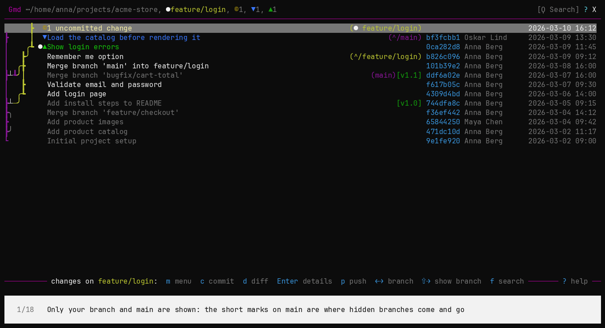
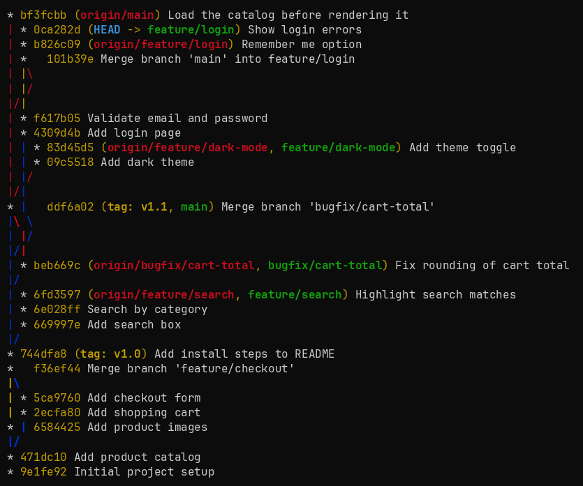
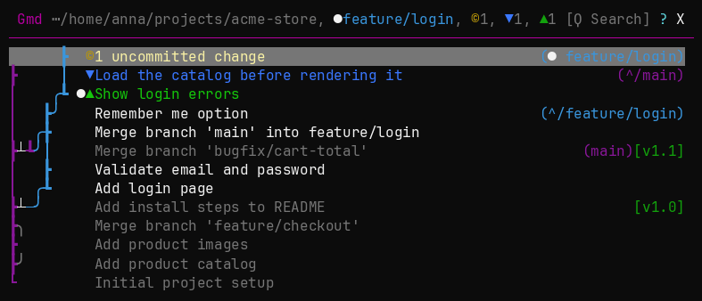

# Gmd

[](https://github.com/michael-reichenauer/gmd/actions/workflows/build-and-release.yml)
[](https://github.com/michael-reichenauer/gmd/releases/latest)
[](LICENSE)


Gmd is a Git client for the terminal, on Linux, macOS and Windows. It draws your history as a
branch graph where **you choose which branches are shown**, so the log stays clean without
rebasing or squashing. The everyday Git commands are in menus and on single keys, so you don't
need to remember their syntax.


*Showing two hidden branches, one of them deleted long ago, a commit's diff, a search, then a
commit, a push and an update of every shown branch.*

## Quick Install

On macOS and Linux, with [Homebrew](https://brew.sh):

```bash
brew install michael-reichenauer/tap/gmd
```

Or without Homebrew:

```bash
curl -fsSL https://raw.githubusercontent.com/michael-reichenauer/gmd/main/install.sh | bash
```

On Windows, in PowerShell:

```powershell
irm https://raw.githubusercontent.com/michael-reichenauer/gmd/main/install.ps1 | iex
```

In a dev container, add the feature `ghcr.io/michael-reichenauer/gmd/gmd:1` to its `devcontainer.json`.

Then run `gmd` in a Git repository. [Installation](#installation) has the details, and the files to
install by hand.

## Why Gmd

Most Git clients show every branch at once, and in a busy repository the log soon becomes a
tangle of lines. Teams often rebase or squash to keep it readable, which rewrites history.

Gmd leaves the history as it is and lets you choose what to look at. A developer may follow just
`main` and their own branch, while a team lead follows `main` and a few feature branches.
Showing or hiding a branch is instant and can be undone at any time, with `Backspace`. It works like
a squash merge that you can take back, and it never touches the history.

Here is a small repository with five branches, and a sixth merged and deleted, as git's own log
draws it:

```bash
git log --graph --oneline --decorate --all
```


And here as gmd first shows it, while you work on `feature/login`: your branch and `main`, each in
a column of its own, and the other branches hidden.



Git does not record which branch a commit was made on. Gmd works that out from your reflog, the
merge messages and the branch structure, which is how `feature/checkout`, merged and deleted long
ago, still has commits of its own that can be shown. When it cannot tell, it marks the branch as
ambiguous, and you can set it by hand.

## Reading the Graph

In the picture above:

- **`main` runs down the left** (`┣`, down to `┗` for its first commit), and each branch has a
  column of its own to the right of the branch it was made from, here `feature/login`.
- **Each branch has a color of its own**, its column and its name in brackets. The commits of the
  branch you are on are white, and those of the other branches gray.
- **A branch and its copy on origin** are two columns side by side, origin's on the left: `▼`
  marks a commit to pull (`Load the catalog before rendering it`, on `^/main`) and `▲` a commit to push
  (`Show login errors`). `^` is short for origin.
- **`●` is the commit you have checked out** and `(● feature/login)` the branch you are on.
  `©1 uncommitted change` is what you have not committed yet.
- **The thin lines between the columns** join a commit to a parent in another column: `╮` down to
  `╰` where a branch was merged into the one on its left, and `╭` down to `╯` where it was made
  from the one on its left, or had that one merged into it.
- **The dark marks beside `main`** (`┣╮`, `┣╯`, `┴`) are hidden branches merged in or made at
  that commit. A click there, or `←` to highlight `main` on that row and `Enter`, shows them, and
  `Shift-→` lists every branch to show.

The help, on the `?` key, starts with the same tour of the screen, including the top bar.

## Is Gmd for You?

Gmd works best when:

- Branches are **merged with merge commits**: git-flow, pull requests merged with a merge commit,
  long-lived release branches. Each merge records which branch came in, which is what keeps a
  branch's column after the branch itself is deleted. Gmd's own merges always make one.
- Many branches exist at once, your team's or your AI agents', and you want to follow a few.
- You work in a terminal, including over ssh and in containers.

It has less to show when every pull request is **squash merged or rebase merged**: `main` is then a
straight line, the branches leave nothing behind once deleted, and there is little to hide. Gmd is
still a complete terminal client there, and it knows that workflow: a branch squash merged or rebase
merged on origin is marked `✓` rather than looking unmerged, **Delete Merged Branches** cleans them
up, and a branch you rebased or squashed after pushing it is pushed with force when you ask, rather
than pulled back to its old version.

Known limits:

- Only the remote named `origin` is supported.
- A terminal without 24-bit color, e.g. macOS Terminal before macOS 26, needs **Colors** set to `16`
  in **Config ...**: gmd draws in colors of its own, dark or light by the terminal's background.
- The log reads the latest 50,000 commits.
- A password, a passphrase or whether to trust a host is asked in a dialog, but only for a command
  you ran. The fetch gmd runs in the background never asks: when it needs a login, it says so, and
  `r` fetches and asks. An ssh older than OpenSSH 8.4 (2020) asks on the terminal instead.

## Gmd and AI Coding Agents

Coding agents such as Claude Code work in branches and worktrees of their own, often several at
once. Gmd keeps that readable rather than letting it flood the log:

- ✦ in the top bar counts the hidden branches with something new, an agent's new branch included,
  and a click lists them, without showing them all.
- `w` lists the worktrees, which ones have uncommitted changes, which are in use by a running
  Claude Code session, and whose branches are merged, by a squash on GitHub too. Open, add or remove
  them there.
- A branch checked out in another worktree is marked `⌂`, and `s` on it opens that worktree.
- **Delete Merged Branches** lists the branches whose pull requests were merged, squash merged
  ones included, and deletes them here, each one restorable.
- An agent's rebase or amend of a branch it had pushed is told apart from new commits on origin,
  and `p` replaces origin's old version with force, after asking.
- When something goes wrong, **Undo** takes back the last change of a branch (a commit, a merge,
  a rebase, a reset), **Recover Lost Commits** finds the work a reset or a rebase left behind,
  and **Restore Deleted Branch** brings back a branch deleted by mistake. Commits made on the wrong
  branch are moved to a new one with **Move to New Branch**.

## Features

**See what matters**

- **Branch visibility**: show and hide branches, pick them from lists of recent, active, your
  own or deleted branches or find one by typing part of its name, and see markers where hidden
  branches merge in or branch out, and a count of the hidden branches with something new since
  you last looked, new branches included.
- **Side-by-side diff** of a commit, the uncommitted changes, a stash, or two branches, with the
  code in the colors of its language. The context shown around the changes can be widened for one
  file at a time, up to the whole file, and the changes of whitespace alone can be hidden.
- **Blame** that groups lines by the commit that last changed them and shades each commit by its
  age, the code in the colors of its language. You can step back to the version before a commit to
  get past a reformat or a rename, or see every commit that changed the lines you select.
- **Search** of the messages, the changed files and the changes themselves, stepping through the
  matches in the log, and of the lines of a diff or a blame.
- **Diff any two commits**, wherever they are in the log.

**Do it without the syntax**

- **Everyday Git**: commit all the changes, the files you tick, or some lines of a file (with spell
  check), push and pull
  (every shown branch at once if you like), merge in either direction, create, rename and delete
  branches, tags (a list of them, to push or remove), stash, cherry pick of one commit or the ones
  you select, a reset of the branch to any commit, and file history.
- **Tidy up a branch**, before you push or after: amend any commit of it, with a new message or the
  changes you tick, drop one, squash several, or move one above or below the next, and Undo takes
  each back. Once on origin, the rewrite is pushed with force, when you tick its box or with `p`
  later, and a branch others build on, such as main, is asked about first.
- **Conflict resolver** for merges, rebases, cherry picks and reverts. It shows both sides next to
  each other, as what each did to the common ancestor, combines both where they changed other
  words, and takes you through the files one after the other, with the file as it will be saved
  below. When you are done you can commit or continue, skip or abort the operation.
- **Worktrees**: see every worktree of a repository and which ones have uncommitted changes, and
  open, add or remove them.
- **Open in the browser**: a branch, a commit or the repository on GitHub, GitLab, Bitbucket, Azure
  DevOps or Gitea, or the page for a pull request into the branch the branch was made from.

**A way back**

- **Undo** the last change of a branch, whether it was made in gmd or not, and redo it.
- **Recover lost commits** that no branch has any more, and **restore deleted branches**.
- Commands that would throw work away ask first.

**Anywhere**

- **Keyboard and mouse**: every command is in a menu, the common ones also have a single-key
  shortcut, and the mouse works for highlighting, menus and switching branches.
- **Works over SSH and in containers**: when no clipboard tool is available, gmd copies through
  the terminal instead (OSC 52), if the terminal supports it, and a link it has no browser to open
  in is copied the same way.
- **Keeps itself up to date** with a built-in update check and a one-click update.
- **Shared branch structure** (off by default, turned on per repository): which branch each commit
  is on, as you set it by hand and as your reflog says, can be shared through origin with others
  using gmd, for the commits origin has, so that you all see the same graph.

## Getting Started

Start gmd in a folder of a Git repository:

```bash
cd my-repo
gmd
```

Started outside a repository, gmd shows a start page: the repositories you opened before, and the
ones in the folder you started it in, each with a number to open it by (`Enter` opens the most
recent), and keys to browse to a repository, clone one or create a new one. `gmd -d <path>` opens
the repository at `<path>`, and `gmd --help` lists all the command-line options.

Your first five minutes:

1. The log shows `main` and the branch you are on. The dark marks beside `main` are the hidden
   branches.
2. `Shift-→` and type part of a branch's name to show it. `Backspace` takes it back.
3. `←` and `→` highlight a branch, and `m` opens its menu, which has every command and its key.
4. `d` shows the diff of a commit, `c` commits and `p` pushes.
5. `?` opens the help in the browser, starting with how to read the screen.

A few keys to start with:

| Key       | What it does                                              |
| --------- | --------------------------------------------------------- |
| `m`       | The menu of the highlighted branch or the current commit  |
| `←` `→`   | Highlight a branch in the graph                           |
| `Shift-→` | Choose which branches are shown                           |
| `Enter`   | Show or hide the commit details                           |
| `d`       | Diff of the commit                                        |
| `c`       | Commit                                                    |
| `?`       | Help, with every key and symbol                           |
| `q`       | Quit                                                      |

The line at the bottom of the screen names what the cursor is on, e.g. `commit on dev:`, and shows
the keys that do something there, changing as it moves. The [help guide](gmd/doc/help.md) covers the
rest, and `?` in gmd opens it, the version of it that goes with the gmd you run. Where there is no
browser to open, e.g. over ssh, gmd copies the link instead.

## Installation

Gmd is one self-contained executable, so you don't need to install .NET. It does need `git` on
the `PATH`, and a terminal with a font with box-drawing characters, which most have. Every release on the [releases page](https://github.com/michael-reichenauer/gmd/releases)
has these files:

| Platform              | File                                                      |
| --------------------- | --------------------------------------------------------- |
| Linux x64             | `gmd_linux_x64`                                           |
| Linux arm64           | `gmd_linux_arm64`                                         |
| macOS (Apple Silicon) | `gmd_osx_arm64`                                           |
| Windows x64           | `gmd.exe` (the executable), or `gmdSetup.exe` (installer) |

There is no release for Intel Macs. You don't need admin rights or `sudo` on any platform.
`SHA256SUMS` in each release has the checksums of its files.

### Linux and macOS

With [Homebrew](https://brew.sh), on an Apple Silicon Mac or on Linux:

```bash
brew install michael-reichenauer/tap/gmd
```

Homebrew then updates gmd too, with `brew update && brew upgrade gmd`: gmd still shows ⇓ when
there is a new version, and the command to run. The tap has the stable releases only, not the
previews. If gmd was installed with the script below before, delete `~/gmd` and open a new
terminal, or the shell may go on starting that copy rather than Homebrew's.

Without Homebrew, this one command picks the right file for your OS and CPU:

```bash
curl -fsSL https://raw.githubusercontent.com/michael-reichenauer/gmd/main/install.sh | bash
```

It downloads gmd to `~/gmd/gmd`, checks it against the release's checksums, and adds `~/gmd` to
the `PATH` in `~/.profile` (and on macOS in `~/.zprofile` and `~/.bash_profile` as well). Then
open a new terminal, or run `. ~/.profile` (`. ~/.zprofile` on macOS).

To install by hand instead, use the file for your platform from the table above:

```bash
curl -fsSL --create-dirs -o ~/gmd/gmd https://github.com/michael-reichenauer/gmd/releases/latest/download/gmd_linux_x64
chmod +x ~/gmd/gmd
echo 'export PATH=$PATH:~/gmd' >> ~/.profile
. ~/.profile
```

On macOS, a file downloaded with a browser rather than `curl` is quarantined and will not start.
`xattr -d com.apple.quarantine ~/gmd/gmd` lifts that.

### Windows

This command, in PowerShell, installs gmd for you alone, so it needs no admin rights:

```powershell
irm https://raw.githubusercontent.com/michael-reichenauer/gmd/main/install.ps1 | iex
```

It downloads `gmd.exe` to `%LOCALAPPDATA%\Programs\gmd`, checks it against the release's checksums,
and adds that folder to your `PATH`. Then open a new terminal (restart Windows Terminal if `gmd` is
not found yet) and run `gmd` in a Git repository.

To install by hand instead, download `gmd.exe` from the releases page and put it in a folder on your
`PATH`. Windows warns before it runs a program downloaded with a browser that is not signed, as gmd
is not: **More info** and **Run anyway** start it. The installer on the releases page,
`gmdSetup.exe`, works too, with the same warning: it puts gmd in `C:\ProgramData\gmd` with Start
menu and desktop shortcuts, and **Config ...** in the repo menu can then add it to the `PATH`.

### In a dev container

The gmd feature installs gmd in a [dev container](https://containers.dev), in VS Code or GitHub
Codespaces. Add it to the project's `devcontainer.json`:

```json
"features": {
    "ghcr.io/michael-reichenauer/gmd/gmd:1": {}
}
```

The container then has the latest release each time it is built, and gmd updates itself in it in
between. On a Debian or Ubuntu image the feature also installs what gmd needs and the image lacks:
git, ncurses and ICU. There is no gmd for Alpine images.

### Updating

Gmd checks for new releases every hour and shows ⇓ in its top bar when there is one. Click it,
or pick **Update to Gmd <version> ...**, in green at the top of the menu and of the start page.
Its **Change Log** button shows what the new version brings. From the command line, run:

```bash
gmd --update
```

The update replaces the executable where it is, so the folder must be writable by you. That is
why it needs no `sudo` when gmd is in your home folder. Installed with Homebrew, gmd is updated by
Homebrew instead, as said above. Before it replaces anything, the new version
is checked against the release's checksums and run once, so a download that would not start is
never installed. The **Config ...** dialog can turn the
update check off, update automatically, or allow preview releases, which are built from the
`dev` branch; with Homebrew, which has the stable releases only, the last two are greyed out.

## What Gmd Stores and Sends

In your home folder:

- `~/.gmdconfig`: your settings and recent repositories.
- `~/gmd.log`: a log of what gmd does, started afresh each time it runs (and moved to
  `gmd.log.2.log` if it grows large).
- The library that colors code, written out of the gmd executable into a `gmd` folder of your local
  app data, e.g. `~/.local/share/gmd` on Linux.

In each repository's `.git` folder, files that git never sends anywhere:

- `.gmdconfig`: which branches are shown, their colors and their order, the repository's settings,
  and what **Undo** and **Restore Deleted Branch** need.
- `gmd-metadata.json`: which branch a commit is on, where git alone cannot tell: the branches you
  set by hand, and what your reflog said, kept after git has expired the reflog. Only commit ids and
  branch names. An older gmd kept it in the repository as `refs/gmd-metadata-key-value/data`, which
  gmd moves into this file at its first change.

And two refs of gmd's own in each repository, which git pushes only when told to, e.g. by
`git push --mirror`:

- `refs/gmd/discarded`: the changes you discarded, as commits, for **Restore Discarded Changes**,
  kept as git keeps what is lost, for about 30 days. Being commits, they are in `git log --all`, and
  in tools that draw every ref.
- `refs/gmdtags/origin/*`: the tags origin had at the last fetch, so that a tag deleted on origin is
  told apart from one never pushed.

Over the network, gmd runs git's own fetches and pushes to origin (a fetch every five minutes, to
keep the ▼ counts current), and asks GitHub for the latest release every hour, which **Config ...**
turns off. With the shared branch structure on, it shares the branch metadata through origin too,
as below. Nothing else is sent: there is no telemetry.

The **shared branch structure** is off unless you turn it on for a repository, in **Config ...**,
which first says what it shares. The entries of `gmd-metadata.json` for the commits origin has are
then pushed to origin after a branch, as `refs/gmd-metadata-key-value/data`, and fetched with the
fetches, so that others using gmd who share it see the same branches. The entries for commits not
pushed stay on your machine. `refs/gmd-metadata-key-value-origin/data` is gmd's record of origin's,
and `git push origin :refs/gmd-metadata-key-value/data` removes it from origin.

## Problems and Feedback

[Report a problem](https://github.com/michael-reichenauer/gmd/issues/new?template=bug_report.yml)
or [suggest something](https://github.com/michael-reichenauer/gmd/issues/new?template=suggestion.yml)
in the issues, where the forms ask for what helps: for a problem, the version from **About** in the
repo menu or from `gmd --version`, and the log. `~/gmd.log` is the first place to look when something goes
wrong; **About** shows where it is, and if gmd itself fails, it says so when it ends, with the same
links. The log is begun anew on every start, so copy it before starting gmd again.

## Contributing

[CONTRIBUTING.md](docs/CONTRIBUTING.md) describes how gmd is built, how to set up a machine for it, the
scripts and the conventions.

## Third-party components

- [Terminal.Gui](https://github.com/tui-cs/Terminal.Gui) (MIT) is the console UI toolkit.
- [Autofac](https://github.com/autofac/Autofac) (MIT) handles dependency injection.
- [DiffPlex](https://github.com/mmanela/diffplex) (Apache 2.0) highlights the characters that
  changed within a line of the diff.
- [TextMateSharp](https://github.com/danipen/TextMateSharp) (MIT), with the TextMate grammars of
  VS Code, colors the code in a diff by its language. Their regular expressions are run by
  [Oniguruma](https://github.com/kkos/oniguruma) (BSD 2-clause) through
  [Onigwrap](https://github.com/aikawayataro/Onigwrap) (MIT), a native library embedded in the
  executable (see `gmd/doc/licenses/libonigwrap.license`).
- [WeCantSpell.Hunspell](https://github.com/aarondandy/WeCantSpell.Hunspell) (MPL 2.0 / LGPL / GPL
  tri-license, used under MPL 2.0) is the managed Hunspell port that spell checks commit messages.
- The [SCOWL](http://wordlist.aspell.net) en_US Hunspell dictionary (MIT/BSD, see
  `gmd/doc/spelling/en_US.license`) is embedded in the executable.

## License

[MIT](LICENSE)
