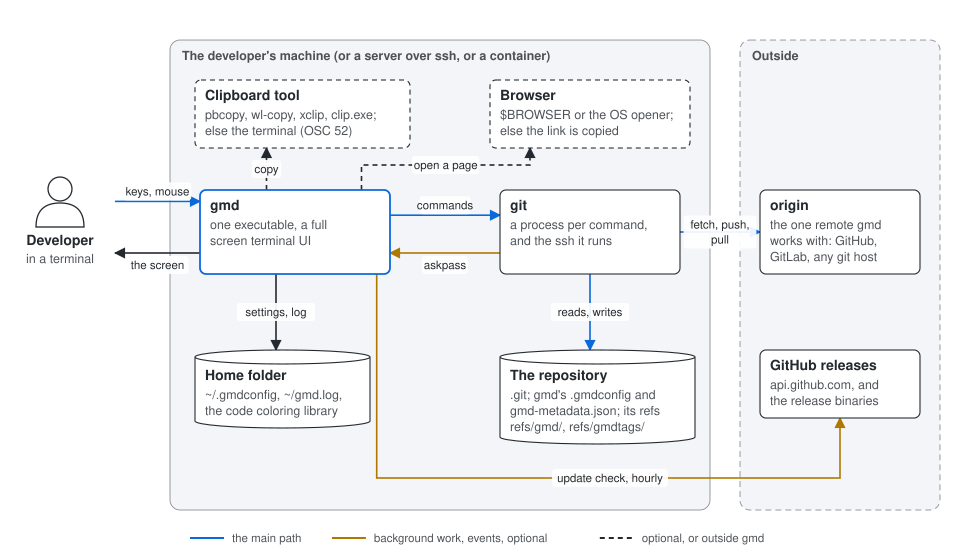
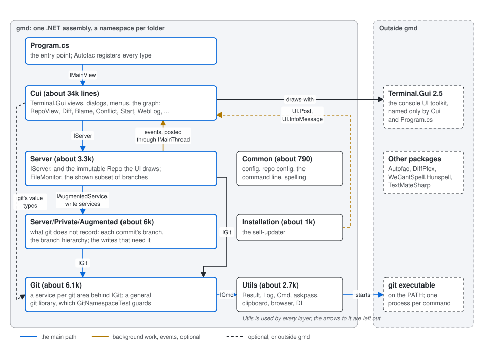
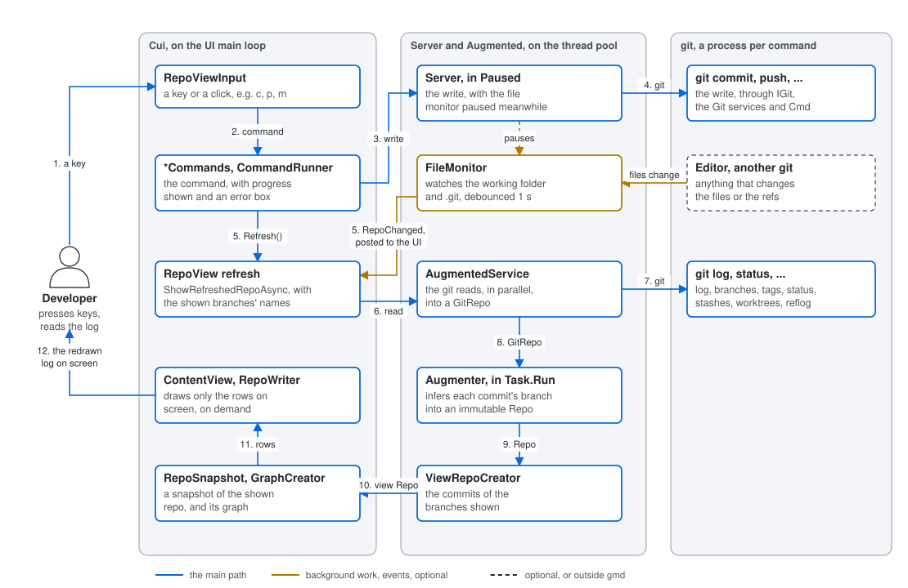
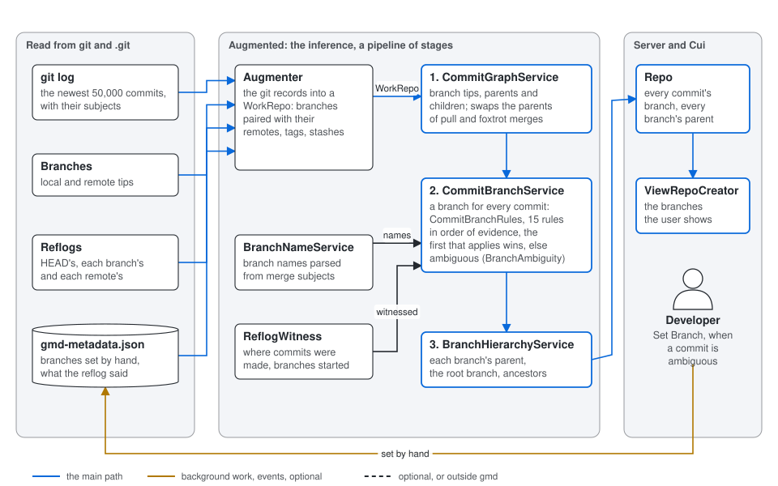
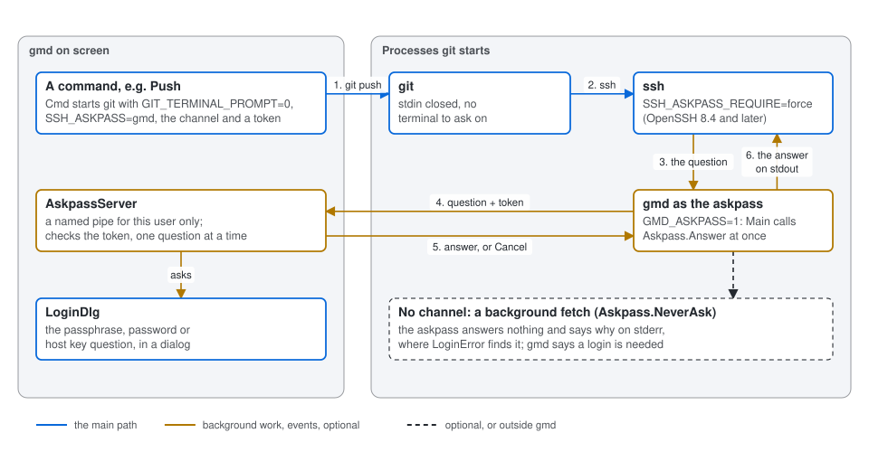
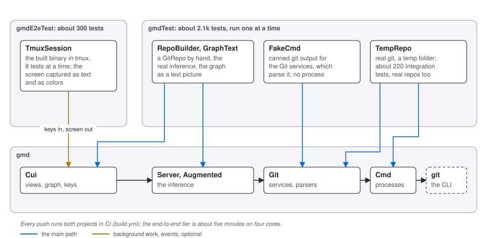

# gmd: architecture

This is a map of how gmd is built, for the people who work on it and plan it: the maintainer, a new
contributor, a later Claude session. It has seven views, each answering one question: who uses gmd
and what it talks to (1), what its parts are and which way they depend (2), how a key or a changed
file becomes a redrawn log (3), how gmd knows which branch a commit is on (4), how git's password
questions reach the user (5), how it is tested (6), and how a commit reaches a user's machine (7).
The code is the source of truth and this document only points into it; where they differ, the code
is right and this document is due an update. The diagrams are generated by
`docs/architecture/generate.py` ([Regenerating the diagrams](#regenerating-the-diagrams)).

## The product at a glance

gmd is a git client for the terminal. It draws the history as a branch graph in which the user
chooses which branches are shown, so the log stays readable without rebasing or squashing, and it
puts the everyday git commands (commit, push, pull, merge, diff, blame, conflict resolution, undo)
in menus and on single keys. Since git does not record which branch a commit was made on, gmd infers
it from the graph, the merge messages and the reflog, and that inference is what the graph is drawn
from.

| | |
| --- | --- |
| Shipped as | One self-contained executable per platform (.NET single file with the runtime inside, some 100 MB), from GitHub releases, a Homebrew tap, `install.sh` / `install.ps1` and a dev container feature |
| Platforms | Linux x64 and arm64, macOS on Apple Silicon, Windows x64; `git` on the `PATH` |
| Stack | C# 15 on .NET 11 (`global.json`), Terminal.Gui 2.5, Autofac, DiffPlex, WeCantSpell.Hunspell, TextMateSharp with Oniguruma; the `git` CLI |
| Size | About 54k lines of C# in about 320 files, of which the UI (`gmd/Cui/`) is about 34k |
| Tests | About 2,100 unit and integration tests (`gmdTest/`, about 1,900 of them fast) and about 300 end-to-end tests in tmux (`gmdE2eTest/`) |
| Releases | By hand with the Release workflow, previews from `dev` and releases from `main`; 124 versions in `CHANGELOG.md` |

## 1. Context view: who uses gmd, and what it talks to



**The developer** runs gmd in a terminal, on their own machine, on a server over ssh or in a
container. gmd takes the whole terminal: Terminal.Gui reads the keys and the mouse and draws the
screen, which is why nothing in gmd may write to stdout (`Log` writes to `~/gmd.log` instead).

**git** is the only way gmd reads or changes a repository. Every read and write is a `git` process
started through `Cmd` (`gmd/Utils/Cmd.cs`), with no git library linked in. `Cmd` sets the same
environment on every one: no editor (`GIT_EDITOR=true`), no optional locks, English messages, and no
prompt on the terminal, which gmd owns. Git's own questions come back to gmd as an askpass (view 5).

**The repository** holds what git holds plus a few things of gmd's, all of them in `.git` and none
in the working tree: `.git/.gmdconfig` (shown branches, colors, undo records), `.git/gmd-metadata.json`
(branches set by hand and what the reflog said, `MetaDataFile`), `refs/gmd/discarded` (discarded
changes, `DiscardedChanges`) and `refs/gmdtags/origin/*` (origin's tags at the last fetch,
`TagService`). gmd never pushes these: every push it makes names a branch, a tag or, when the
shared branch structure is on, the metadata ref (`RemoteService`, `KeyValueService`), and a plain
`git push` sends only branches and tags, so they reach origin only if the user pushes every ref
themselves, e.g. with `git push --mirror`. **The home folder** holds `~/.gmdconfig` (`ConfigService`), the rotating `~/gmd.log`,
and the Oniguruma library that `OnigurumaLibrary` writes out to local app data so that code can be
colored.

**origin** is the one remote gmd works with. gmd fetches from it every five minutes in the
background (`RepoView.FetchFromRemote`), and pushes and pulls when asked. With the shared branch
structure turned on (`RepoConfig.SyncMetaData`, off by default) it also pushes and fetches the
metadata ref `refs/gmd-metadata-key-value/data`. **GitHub's releases API** is asked once an hour
whether there is a newer gmd (`Updater`, `GitHubReleases`), unless the config turns it off. The
**clipboard** and the **browser** are reached through a chain of tools tried in order
(`ClipboardService`, `BrowserService`); where none works, a copy goes through the terminal as OSC 52
and a link is copied instead of opened.

The same executable also runs without the UI: `gmd --version`, `--update`, and `--web-log <file>`,
which writes the branch graph as a web page (`ProgramCommands`, `gmd/Cui/WebLog/`), and as the
askpass of the git it started (view 5).

Points to discuss: everything goes through text that git prints, so each command whose output is
parsed pins its format (`LogService.CommitFormat`, `DiffService.DiffFormat`), and a git that changes
its output breaks gmd without a compile error; the `TempRepo` integration tests are the canary for
that. Only a remote named `origin` is supported. The update check is a network call to a fixed
repository (`GitHubReleases.releasesUri`), and the only one gmd makes itself.

## 2. Code structure view: five layers, and the calls go down



gmd is one project, `gmd/gmd.csproj`, and its parts are namespaces, one per folder. **The layers**
are strict and each is reached through a public interface, with its implementation in a `Private/`
folder: `gmd/Cui/` (the views) calls `IServer`; `gmd/Server/` keeps the immutable `Repo` the UI
draws and calls `IAugmentedService` and the write services of the augmented layer;
`gmd/Server/Private/Augmented/` infers what git does not record (view 4) and calls `IGit`;
`gmd/Git/` is one service per git area, and calls `ICmd`, which starts the process. The server also
calls `IGit` itself for the writes that need no inference, which is most of them (`Server.cs`).

**Program.cs** is the composition root: Autofac registers every type of the assembly by convention
(`DependencyInjection.RegisterAllAssemblyTypes`), so a new class needs no registration, and a class
asks for what it needs in its constructor. It is also, with `gmd/Cui/`, the only place that names
Terminal.Gui.

**The one upward call** is the file monitor's: `FileMonitor` in the server raises its events on the
UI thread through `IMainThread` (`gmd/Utils/IMainThread.cs`), an interface the UI implements
(`MainThread`), so the server never names the UI.

**`gmd.Git` is kept a general git library**, one that could be a package of its own: it uses nothing
of gmd but itself and `gmd.Utils`. `GitNamespaceTest` reads the compiled code and fails if a type in
`gmd.Git` names anything else. Its records are deliberately not the server's, although several are
copies; `GitConverter` turns each git record into the server's, so a change in the git layer does not
ripple up into the UI.

**Beside the layers**: `gmd/Common/` is the config, the command line (`ProgramCommands`) and the spell
checker; `gmd/Installation/` the self-updater; `gmd/Utils/` the `Result` type, `Log`, `Cmd`, the
askpass and the clipboard and browser services, used by every layer.

Points to discuss: only the git layer's boundary is enforced by a test. The others hold by
convention, and there are a few exceptions in the code today: `MainView`, `RepoView` and a handful of
other UI classes call `IGit` directly (`RootPath`, the web links, ref name checks), `Updater` calls
`UI.Post` and `UI.InfoMessage` to say a new version was installed, and `ProgramCommands` in
`gmd/Common/` runs the web log export of `gmd/Cui/WebLog/`. The UI is
nearly two thirds of the code, and its largest files are views of over 1,000 lines (`DiffView.cs`,
`ConflictView.cs`, `CommitCommands.cs`). Because registration is by convention, a second class
implementing an interface silently takes over its resolution, and a stateful class shared by several
others must be marked `[SingleInstance]` or each gets a copy.

## 3. Runtime view: from a key or a changed file to the redrawn log



The log is never patched in place. Whatever changes, gmd reads the repository again, infers the
branches again, and replaces the snapshot it draws. There are two ways in.

**A key** goes to `RepoViewInput`, which finds the command in one of the `*Commands` classes
(`CommitCommands`, `BranchCommands`, ...). `CommandRunner.Do` runs it off the UI thread with the
progress shown, and says a failure in an error box, a `Notice` on the status line, or the conflicts
and the way on when git stopped on them. The command calls the server, and every write the user
asks for runs in `Server.Paused`, which pauses the `FileMonitor` meanwhile, so that gmd's own changes
do not trigger a second refresh. When the write is done the command calls `Refresh()`.

**A changed file**, from an editor, another terminal or the background fetch, is seen by
`FileMonitor` (`gmd/Server/Private/FileMonitor.cs`), which watches the working folder and the git
folders and debounces the events by a second. A change under `.git` (refs, `HEAD`) is a
`RepoChanged`; a change in the working folder is a `FileChanged`, for which only `git status` is read
again (`UpdateRepoStatusAsync`). The events reach `RepoView` on the UI thread, which drops those its
last read has already seen (`ChangeEvent.IsSeenBy`).

**The read** (`RepoView.ShowRefreshedRepoAsync` → `Server.GetRepoAsync`) runs nine reads in
parallel in `AugmentedService.GetGitRepoAsync`: the log of the newest 50,000 commits, the branches,
tags, status, stashes, worktrees, reflog, the user name, and the metadata file. The result is a
`GitRepo`, which the `Augmenter` turns into a `Repo` on a thread pool thread (`Task.Run`), with the
branch of every commit inferred (view 4). `ViewRepoCreater` then keeps the commits of the branches
the user shows. Back on the UI thread, `RepoView.ShowRepo` wraps it in a `ViewRepo` with its `Graph`
(`GraphCreater`), and the `ContentView` asks `RepoWriter` for only the rows on screen as it draws,
so a large repo is never turned into text as a whole.

**Showing or hiding a branch** reads nothing: it filters the `Repo` already read again
(`Server.ShowBranch`, `HideBranch`), which is why it is instant. After a repo is shown, three things
are read in the background without holding it up: the status of the other worktrees, which branches
deleted on origin were squash or rebase merged there (`MergedBranchService`, a `git merge-tree` per
branch), and a fetch.

**The UI thread** is Terminal.Gui's main loop. Work comes back to it through `UI.Post` and the
awaits on it, which go through gmd's own `MainLoopQueue`, and every command takes the snapshot shown
when it runs (`CommandContext`, `Do(async repo => ...)`) rather than keeping one, so it acts on what
the user sees.

Points to discuss: a refresh costs a full read and a full inference, about 1.2 to 2.6 seconds per
100,000 commits by the measurements in `AugmentedService`, which is why the log stops at 50,000
commits (`MaxCommitCount`) and a commit-graph file is written for a large repo that lacks one. The
log of 50,000 commits is a string of megabytes, which is why the project sets
`System.GC.ConserveMemory` (`gmd.csproj`). gmd drops keys while a git command runs
(`KeyGate`), so a key typed during a refresh is lost rather than queued. The refresh logic has grown
careful about races (a read overtaken by a show is read again, up to `MaxReads`; a change told
during a read is kept and looked at after it), and that is where a subtle bug would hide.

## 4. Branch inference view: which branch each commit is on



This is the part of gmd that git does not have, and the most subtle code in the repository. Git
records a branch only as a name for its tip commit; for every other commit, gmd has to work out which
branch it was made on, and how the branches relate, before it can draw a branch in a column of its
own or hide it.

**The Augmenter** (`Augmenter.cs`) turns the `GitRepo` into a mutable `WorkRepo`: branches paired
with their remote branches, tags and stashes on their commits, the worktrees, and what the reflogs say
for Undo and about force pushes (`ReflogSteps`, `RemoteRewrites`, `LocalRewrites`). Then
`BranchStructureService.DetermineCommitBranches` runs the pipeline, one class per stage:

- **`CommitGraphService`** puts the branch tips on their commits and links parents and children, and
  swaps the parents of pull merges and foxtrot merges, so that a first parent is the branch's own
  line (`Commit.IsParentsSwapped` keeps git's order for the commands that need it).
- **`CommitBranchService`** walks the commits from the newest and gives each a branch.
  `DetermineCommitBranch` is an ordered chain of 15 rules (`CommitBranchRules`), where the order is
  the strength of the evidence: a branch the user set by hand first, then a deleted branch named in a
  merge subject, a commit with one branch only, `main` and its kin, what the reflog witnessed
  (`ReflogWitness`), and so on down to rules that reuse a child's branch. When no rule applies the
  commit is ambiguous (`BranchAmbiguity`), and the user can set its branch from the menu.
  `BranchNameService` parses merge subjects ("Merge branch 'x' into y", pull request merges) to
  recover the names of branches git has forgotten.
- **`BranchHierarchyService`** finds each branch's parent branch, the root branch, and each branch's
  ancestors, which the graph's columns and "show this branch" need.

**What the reflog said** is kept: `ReflogWitness` records where commits were made and branches were
started in the metadata (`MetaData.SetWitnessed`), so the inference stays the same after git expires
the reflog. A branch set by hand is kept there too (`MetaDataService`).

Points to discuss: the rules are heuristics, and the order of the chain is the design, so a change
to one can move commits to other branches anywhere in a long history. The tests here are
characterization tests (`RepoBuilder`, `GraphText`), which pin what the code does rather than what it
ought to, and the bar for a change is a before-and-after comparison over real repositories
(`InferenceDumpTest`, with `GMD_INFER_REPO`), not a green suite. Repositories whose pull requests are
squash or rebase merged leave little to infer, so gmd has less to show there. The inference runs one
at a time (a static lock in `BranchStructureService`), as the stages share `BranchNameService`'s
cache.

## 5. Login view: git's questions asked in gmd's own dialog



Git, and the ssh it runs, ask for a password, a passphrase or whether to trust a host on the
terminal, and the terminal is gmd's: a question drawn there scrolled the UI and took the keys typed
for gmd. So gmd answers the questions itself, in a dialog.

**`Cmd.NeverAskOnTheTerminal`** starts every git with `GIT_TERMINAL_PROMPT=0`,
`SSH_ASKPASS_REQUIRE=force`, stdin closed, and gmd's own executable as `SSH_ASKPASS` (git asks it
too when there is no `GIT_ASKPASS`). For a command that may ask, it also passes the name of a
channel and a random token. **ssh then runs gmd as its askpass**: `Main` sees `GMD_ASKPASS=1` before
anything else and calls `Askpass.Answer`, which connects to the channel and passes the question.
**`AskpassServer`** in the gmd on screen listens on a named pipe opened for the current user only,
checks the token, and asks one question at a time in `LoginDlg`. The answer goes back over the pipe
and out on the askpass's stdout, where ssh reads it.

**A background command never asks**: the fetch and the metadata sync run inside
`Askpass.NeverAsk()`, so they get no channel, and the askpass says on stderr that it did not ask.
`LoginError` finds that in git's error output, and gmd says that a login is needed and that `r`
fetches and asks.

Points to discuss: an OpenSSH older than 8.4 ignores `SSH_ASKPASS_REQUIRE` and still asks on the
terminal. The askpass is not yet tried on Windows. A gmd left running after an update starts the new
binary as its askpass, so the channel's protocol must stay compatible between versions. A user's own
credential helper or `GIT_ASKPASS` is left alone, which is right, but means some logins never reach
this dialog.

## 6. Test view: from a fake git to the real binary in a terminal



The tests are in two projects, and four tools between them reach different depths of the stack.

**`FakeCmd`** (`gmdTest/Utils/`) stands in for `ICmd`, so every git service's parsing is tested with
canned output and no process. **`RepoBuilder`** (`gmdTest/Fixtures/`) builds a `GitRepo` by hand,
newest commit first, and runs the real inference, up to the `Repo` the UI renders, with fakes for the
rest (`FakeGit`, `FakeRepoConfig`, ...); **`GraphText`** draws the graph of the result as text, so an
expected graph is a picture in a raw string. **`TempRepo`** runs the real `git` in a throwaway
repository, the canary for git versions and output formats; these tests carry the `Integration`
category, about 220 of them.

**`TmuxSession`** (`gmdE2eTest/Fixtures/`) is the end-to-end tier: the built binary in a tmux pane,
with a throwaway `HOME`, keys sent with `send-keys`, and the screen read back with `capture-pane`, as
text and as colors. Started with `GMD_E2E=1`, gmd writes whether it is idle as the terminal's title
(`E2eProbe`), which the tests wait on instead of sleeping. These tests run eight at a time; `gmdTest`
runs one test at a time, since some of its tests change process-wide state (the culture,
`GIT_EDITOR`).

`scripts/test` runs both projects, about a minute on a developer machine and about five on a
four-core VM or CI runner, and `--filter "TestCategory!=Integration"` runs the fast tests alone in
about a second. Everything that draws is kept apart from the logic it draws (`ContentScroll`,
`Hoover`, `KeyHints`, `DiffRows` and many more have no view), so most of the UI is tested without a
terminal.

Points to discuss: the end-to-end tier is timing-sensitive by nature, and most flaky failures in CI
have been there; the idle handshake and `scripts/test --stress` exist for that. Terminal.Gui can draw
headlessly, which would test drawing without tmux, but the suite does not use it yet. The inference
tests are characterization tests, so a green run says the code did what it did before, not that it
is right.

## 7. Delivery view: from a commit to a user's machine


**Branches**: work happens on feature branches, merged into `dev` through pull requests; `main`
holds the releases and moves only through the Release workflow. **`build.yml`** runs on every push
to any branch and on pull requests into `dev` and `main`: the CSharpier format check first, then
`scripts/build -l`, which runs both test projects and publishes the two Linux builds. It publishes
nothing: a merge only tests.

**`release.yml`** is run by hand (`gh workflow run release.yml -f kind=preview`, or the `release`
skill). A preview builds `dev` as it is and publishes a GitHub pre-release. A release stamps the
`## [Unreleased]` notes of `CHANGELOG.md` with the version on `dev`, merges `dev` into `main` with
`--no-ff`, raises `MinorVersion` on `dev`, builds and tests the merge for all four platforms, and
only then pushes `dev` and `main` together and publishes the release with its assets: the four
binaries, `gmdSetup.exe` (a prebuilt installer committed to the repository), two copies under the
names older versions update from, and `SHA256SUMS`. It then writes the Homebrew formula into the tap
`michael-reichenauer/homebrew-tap` with a deploy key, and prunes previews beyond the latest five.
The version is `major.minor.days.minutes` (`gmd/Build.cs`, whose `BUILD_TIME` and `BUILD_SHA`
placeholders the workflow replaces).

**Users** get a release four ways: gmd's own updater (`gmd/Installation/`), which checks hourly,
downloads the binary, checks it against `SHA256SUMS`, runs it once to see that it starts, and swaps
it in; `install.sh` and `install.ps1`; Homebrew, in which case gmd leaves the updating to it
(`PackageManager`); and the dev container feature, which `devcontainer-feature.yml` tests on every
change to it and publishes to ghcr.io from `main`. Beside this, **`branch-graph.yml`** builds gmd and
runs `gmd --web-log` to publish this repository's branch graph to GitHub Pages hourly, after each
release and on every push, and `downloads.yml` snapshots the release download counts weekly into the
branch `stats`.

Points to discuss: the updater of one version installs the next, so a bug in it ships unseen and
shows one release later, at users who can then only reinstall by hand; what released versions rely on
(asset names, `SHA256SUMS`, the tag format) must not change. The release notes are written by hand,
and a run that fails after its push leaves the branches moved but nothing published, to be finished
by hand (`docs/RELEASING.md`). Windows is built and released, but CI builds and tests on Linux
only, and `gmdSetup.exe` can be rebuilt only on Windows. A Debug build reformats the
sources (CSharpier), which is why CI checks the format before it builds.

## Key design decisions

| Decision | Why | What it costs |
| --- | --- | --- |
| Run the `git` CLI for everything, with no git library | Git behaves exactly as the user's own: their config, hooks, credential helpers and signing (inferred) | A process per command, text to parse, and guards on every process (`Cmd`: no editor, no prompt, no optional locks, English); formats pinned per command |
| Infer each commit's branch rather than ask for a workflow | The product's point: a readable log of the history as it is, with no rebasing or squashing (README) | The most subtle code in the repository, heuristics that can be wrong (ambiguous commits, set by hand), and characterization tests plus inference dumps to change it safely |
| Re-read and re-infer the whole repo on every change, into an immutable `Repo` | A command acts on the snapshot shown when it runs (CLAUDE.md); one way to read is simpler than updating a model in place (inferred) | 1.2 to 2.6 s per 100,000 commits, so the log stops at 50,000; memory for a megabytes-long log; careful handling of reads overtaken by changes |
| Strict layers behind interfaces, `gmd.Git` a general library | A change in git's model does not ripple into the UI (CLAUDE.md) | Twin records (`Git.Commit`, `Server.Commit`) and `GitConverter`; a pattern on the wrong twin compiles and never matches; only the git layer is checked by a test |
| `Result` unions instead of exceptions | Failures are values a reader sees at a glance; exceptions are left for bugs (CLAUDE.md, `.claude/rules/workflow.md`) | Needs C# 15 and .NET 11; every call site matches its result; misuse throws `ResultException` at run time |
| Dependency injection by convention (Autofac scanning the assembly) | No registration code to write for a new class (CLAUDE.md) | A second implementer silently wins; a shared stateful class must be marked `[SingleInstance]`; tests wire the inference by hand (`RepoBuilder.NewAugmenter`) |
| One self-contained executable with its own updater | No .NET to install (README); one file to download, check and swap | Some 100 MB per release; native Oniguruma embedded and written out at run time; an updater bug reaches users a release late |
| Ask git's questions through gmd as the askpass | A prompt on the terminal broke the UI and took the user's keys (`Cmd.NeverAskOnTheTerminal`) | A second gmd process and a named pipe per question; background commands can never log in; old OpenSSH still asks on the terminal |
| Test the real binary in tmux | Drawing, layout, key dispatch and dialogs are reached by nothing else (CLAUDE.md) | About 300 slow, timing-sensitive tests; an idle handshake (`GMD_E2E`) built into gmd for them |
| Publish only by hand, with notes written for users | A merge never ships anything, and notes are written for users rather than generated from merge messages (`docs/RELEASING.md`) | Someone writes the notes for each release; a failed run is finished by hand |

## Where to start reading the code

| To understand | Start at |
| --- | --- |
| How gmd starts, and its command-line modes | `gmd/Program.cs`, `gmd/Common/ProgramCommands.cs` |
| How the log is read, refreshed and drawn | `gmd/Cui/RepoView/RepoView.cs` (`ShowRefreshedRepoAsync`, `ShowRepo`), then `gmd/Server/Private/Server.cs` |
| What the UI is given | `gmd/Server/Repo.cs`, `gmd/Server/IServer.cs` |
| What a key does | `gmd/Cui/RepoView/RepoViewInput.cs`, `LogKeys.cs`, the `*Commands.cs` beside them |
| How the branches are inferred | `gmd/Server/Private/Augmented/Private/BranchStructureService.cs`, then `CommitBranchService.cs` and `CommitBranchRules.cs` |
| How git is run and parsed | `gmd/Git/IGit.cs`, `gmd/Git/Private/LogService.cs`, `gmd/Utils/Cmd.cs` |
| How the graph is drawn | `gmd/Cui/Graphs/GraphCreater.cs`, `GraphWriter.cs` |
| The diff, blame and conflict views | `gmd/Cui/Diff/DiffView.cs`, `gmd/Cui/Blame/BlameView.cs`, `gmd/Cui/Conflict/ConflictWorkspace.cs` |
| Errors and results | `gmd/Utils/Result.cs`, CLAUDE.md "Errors" |
| The file monitor | `gmd/Server/Private/FileMonitor.cs` |
| Logins | `gmd/Utils/Askpass.cs`, `AskpassServer.cs`, `gmd/Cui/Login/LoginDlg.cs` |
| The updater | `gmd/Installation/Updater.cs`, `BinaryInstaller.cs` |
| Testing | `gmdTest/Fixtures/RepoBuilder.cs`, `GraphText.cs`, `TempRepo.cs`, `gmdE2eTest/Fixtures/TmuxSession.cs` |
| Releasing | `docs/RELEASING.md`, `.github/workflows/release.yml` |

CLAUDE.md has the conventions and the traps in more detail, `docs/CONTRIBUTING.md` how to set up a
machine, and `docs/BRANCH-GRAPH.md` the web branch graph.

## Risks and open topics

- **The inference is the product and the risk.** A change to a rule or its order can reassign
  commits far away in a long history, and only a before-and-after dump over real repositories shows
  it (`InferenceDumpTest`).
- **The UI is two thirds of the code.** The log view's folder alone is about 10k lines, and the
  largest views are over 1,000 lines each; the logic kept apart from the views is what keeps them
  testable.
- **Layer boundaries other than the git layer's are kept by convention.** The few upward and
  skipping references (UI to `IGit`, `Common` and `Installation` to the UI) could grow unnoticed.
- **The updater cannot be fixed after the fact.** A gmd with a broken updater can only be
  reinstalled by hand, so every change to `gmd/Installation/` is tried through previews on all three
  systems first (`.claude/rules/installation.md`).
- **Large repositories.** A refresh is a full read and inference, bounded by the 50,000 commit cap;
  repositories larger than that see only their newest commits.
- **Timing in the end-to-end tests.** The tmux tier needs the idle handshake to be reliable, and
  failures under load are still possible (`scripts/test --stress` reproduces them).
- **Windows is the least tried platform.** It is built and released, but CI runs on Linux, the
  installer is a committed binary, and the askpass has not been tried there.
- **Terminal.Gui 2.x behavior** (a main loop that sleeps between iterations, focus changes that
  throw, views marked drawn after a draw) shapes how the UI code is written; CLAUDE.md, "UI threading",
  lists the traps.

## Regenerating the diagrams

The diagrams and the numbers come from one script, which needs only Python 3:

```bash
python3 docs/architecture/generate.py           # writes docs/architecture/<n>-<view>.svg
python3 docs/architecture/generate.py --count   # prints the numbers this document gives
```

Each diagram is one function in the script that places its elements by hand, so a change to a
diagram is a changed line. Look at every diagram after generating it: render it to a PNG (a headless
browser screenshot of an HTML page with the SVG inlined works; a `file://` SVG may time out) and fix
overlapping text and arrows that cross boxes before committing. The script warns when a card's text
looks wider than the card.

How the numbers are counted, so that the next count is comparable:

- **Lines of code** are physical lines, blank lines and comments included, of the `.cs` files under
  `gmd/`, without `obj/`, `bin/` and the vendored `gmd/Utils/GlobPatterns/`. A module is a folder of
  `gmd/`; `Server` is counted without `Server/Private/Augmented/`, which is counted on its own.
- **Tests** are the `[TestMethod]` declarations in `gmdTest/` and `gmdE2eTest/`; a `[DataRow]` is not
  counted, though the runner lists each as a test of its own (it lists about 2,700). A test is
  Integration when its class or the method carries `[TestCategory("Integration")]`; all of
  `gmdE2eTest` is, by its assembly attribute.
- **Releases** are the `## [v` headings in `CHANGELOG.md`.
- The inference view reads the number of rules (`rules.Try...` in `CommitBranchService.cs`) and the
  commit cap (`MaxCommitCount`) from the code; the code structure and test views take their sizes
  from the counts above, rounded to two figures.

What goes stale first: the numbers in the prose and the table at the top, which the script does not
write, so recount them with `--count`; the runtime view, whenever `RepoView` or the command classes
are reorganized; and the delivery view, whenever a workflow changes. When this document and the code
disagree, the code is right.
